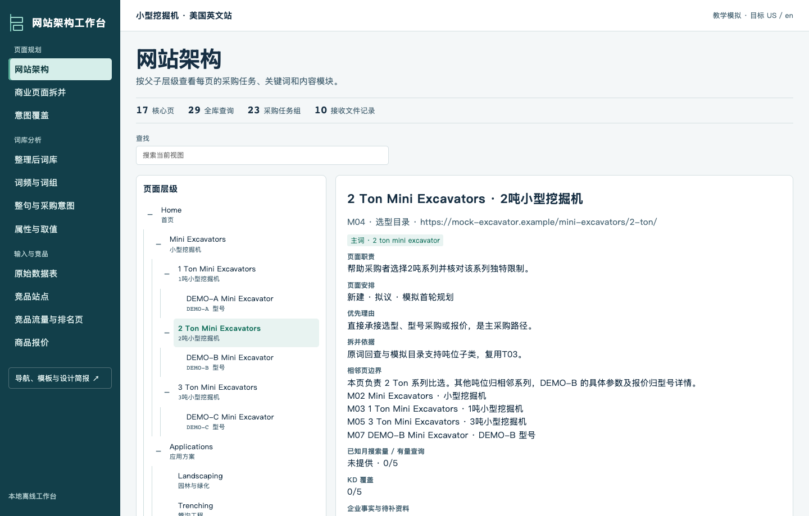
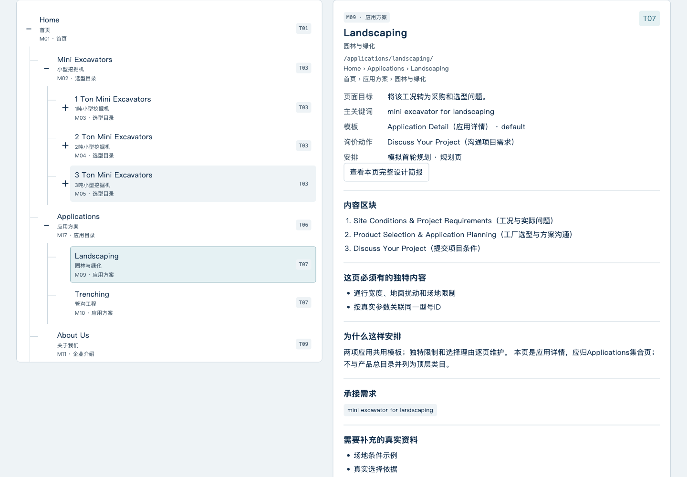

# B2B 网站架构规划 Skill

**把行业词库、竞争对手页面和企业资料，变成可以交给设计师或 AI 的网站规划。**

适合准备建设或改版英文外贸 B2B 网站的工厂、外贸企业和服务团队。版本 **0.9.0**。

它帮助你确定：网站建哪些页面、产品类目怎么分、应用方案怎么归类、类目页放哪些筛选器、产品详情需要填写哪些参数，以及哪些页面可以共用模板。

## 打开交付工作台

打开 Codex 交付的网址，每页占一行。你可以决定这页要不要建、要不要开始做 SEO，也可以看到页面是否已建、优化稿是否已经发布。Builder 和 On-page 在实际工作完成后回写时间、摘要和证据。点击页面名可以查看对应的词、竞品网址和内容依据。

例如，2 吨挖掘机系列页可选「要建」并安排 SEO，3 吨系列页可选「不建」，电动系列可留待供货核实。后续 Codex 从同一网站项目直接读取这些决定。需要审阅某个草案时，也可复制该版工作台网址。

重开时，已安装 Skill 的 Mac 可以双击成果目录里的 **打开可编辑工作台.command**。也可运行 `python3 <本Skill目录>/scripts/workbench.py --workbench <成果目录>`。本机服务沿用原地址与已保存的选择。换电脑继续维护时一起移交整个建站项目，包括根 AGENTS.md、隐藏的 .seo-architecture 目录、各版工作台和执行回执。双击 `index.html` 可打开只读预览。

自动接续和回写已经在 On-page SEO v2.12.0 与 WordPress Builder Harness 2.39.26-r21 上联测。项目里工作时可以直接对 Codex 说「把我勾选要建的页面存成 WordPress 草稿」或「优化我安排了 SEO 的页面」。



“输入与竞品”集中展示原始 CSV、客户补充的产品工作簿和业务材料、竞品站点、Top Pages、各次排名与商品报价。整页流量和商品价格各有口径，原件保留可下载。工作台支持离线查阅与分页，交付时发送整个成果目录或其 ZIP。On-page 按页面编号读取确认的词组和模块，继续写 Title、H1、Subtitle、H2 和正文。[逐页规划与数据契约](skills/b2b-seo-site-architecture/references/search-planning.md)

在建站项目中，交付后打开网站根目录的 **AGENTS.md**。里面直接链接当前市场的工作台、网站页面规划、清洗后的行业词库与逐词归属、竞品排名与 Top Pages、用户提交的原件。换一个会话也能沿这些链接继续优化指定页面。[登记现有工作台的方法](skills/b2b-seo-site-architecture/references/output-contract.md)

当前版本的安装包和校验清单可从 GitHub 下载。[下载 v0.9.0 ZIP](https://github.com/jackzhang1314/b2b-seo-site-architecture/releases/download/v0.9.0/b2b-seo-site-architecture-0.9.0.zip) · [下载校验清单](https://github.com/jackzhang1314/b2b-seo-site-architecture/releases/download/v0.9.0/b2b-seo-site-architecture-0.9.0.manifest.json)

新生成的工作台先作为草案。选定后，可告诉 Codex「采用这个目录里的架构方案」，或对该目录执行 `architecture.py --project-root <网站> --register-existing <工作台> --adopt`。未指定网址时，On-page 和 WordPress Builder 使用当前采用版。首次只有一份草案且用户已选择页面时，可以直接继续已选工作。发给 Codex 具体工作台网址时，使用该版选择。以后有新增词库或同行数据，把新增原表发给该网站项目的 Codex，让它基于原版更新工作台。审阅草案的单页时，从工作台复制该页的 On-page 指令。完整项目中可看版本变化，从当前页切换到另一版的相同位置。

## 怎样安装到 Codex

把下面这段话复制给 Codex：

```text
请使用 $skill-installer 安装这个 Skill：
https://github.com/jackzhang1314/b2b-seo-site-architecture/tree/v0.9.0/skills/b2b-seo-site-architecture

请检查安装是否成功，并告诉我怎样调用。
这一步先完成安装，不开始网站规划或建站。
```

安装完成后，下一轮对话即可使用 `$b2b-seo-site-architecture`。如果当前界面还没显示，可以新建一个会话。安装同名旧版时，先让 Codex 核对版本、备份已有副本，再更新。

这是一份独立 Skill，所需脚本和 HTML 模板都已包含，**不用先安装整套 SEO Skill 或 WordPress Builder**。

使用环境需要：

- 能读取本地文件、使用 Skill 的 Codex。
- Python 3.11 或更新版本；脚本只用 Python 标准库。
- 进行竞品实访时，需要当前环境中可用、已授权的浏览器控制能力。缺少时可继续整理资料和做暂定方案，实访部分会明确标为未完成。

Skill 不包含 Ahrefs、Semrush 账号或付费数据。你已有的工具导出文件可以直接提供。

## 我需要提供什么

| 资料 | 可以直接提供的内容 |
| --- | --- |
| 企业与产品资料 | 实际产品、型号/材料、制造或供货范围、目标国家、英文站语言、图片与已有证书资料 |
| 产品核心词或拓词表 | 几个产品名或别名即可开始。已有的 Semrush、Ahrefs 导出或 AI 候选词表可以直接交 |
| B2B 独立站竞品名单 | 已知同行域名或官网网址。名单缺失时，Codex 按采购商的搜法找站，结合行业词的流量分布核对同行 |
| 每站前 30 名的排名词 | 导出自然排名位置 1–30 的所有可得关键词、名次与具体页面 URL，已有更广的排名原表也可交 |
| 每站的 Top Pages | 单独导出页面 URL 和整页估算自然流量。已有报价时保留币种、单位、配置及贸易条件 |
| 现有网站（改版时） | 网站地址、已有页面及可得的表现数据 |

把公司介绍、产品目录和这些原件放进**同一个客户文件夹**，把文件夹交给 Codex 即可。Codex 会盘点已有文件、清洗和关联原表，再生成客户工作台与架构设计简报。

**如果你只有工厂资料**，可以直接说“我们做定制玻璃酒瓶，目标是美国。请从产品目录提取核心词，帮我找 B2B 独立站同行，再告诉我在 Ahrefs 要下载哪两张竞品表、放在哪里。”你可以自行导出，也可以授权 Codex 通过 Computer Use 在你使用的网页版操作。[四份资料的收集方法](skills/b2b-seo-site-architecture/references/data-collection-guide.md)

## 安装后，怎样开始

把资料放进当前项目或作为附件提供，再复制：

```text
使用 $b2b-seo-site-architecture。

我提供企业与产品资料、行业词库、竞品名单、Top Pages，以及竞品排名关键词和对应 URL 表。
我们做英文外贸 B2B 网站。

请先用脚本统计词频、词组、产品属性和竞品页面承接的需求，再结合语义分析与浏览器实访，规划网站架构。

所有页面、类目、导航、模块标题和产品属性以英文为主，附中文翻译帮助我理解。
请明确应用方案集合页与二级详情的归属，规划产品类目筛选器和产品详情关键字段。

请交付可离线打开的网站架构与词库工作台、完整 CSV 和设计简报。我需要能从一个采购问题查到全部成员词、承接页、内容模块、竞品依据、原始记录和待补的资料。本轮只规划商业页面及必要的企业和采购支持页。
先完成规划，暂不制作或发布网站。
```

只做一条产品线、排除博客或已有部分研究时，直接补充说明即可，不必重跑全部流程。

## 最后会拿到什么

| 成果 | 用来做什么 |
| --- | --- |
| `workbench-handoff.json` | 已保存的逐页选择、SEO 排期、建页/优化回执、版本与交接资料 |
| `index.html` | 在架构树、词频、整句意图、竞品和原始表之间切换，从具体需求查到页面、模块与来源 |
| `design.html` | 查看导航、模板、产品属性以及可复制的逐页设计简报 |
| `commercial-planning.csv`、`keyword-decisions.csv`、`content-modules.csv` | 查每个取值与采购任务的拆并理由、每个词的主归属，以及具体由哪个模块回答 |
| `research-report.md` | 回查竞品核心页拆解、研究范围、采用理由和未完成项 |
| `pages.csv`、`navigation.csv`、`templates.csv` | 交给设计与建站团队，明确页面归属和模板复用 |
| `product-attributes.csv` | 明确属性的定义/单位、类目筛选用途、详情字段和缺值处理 |
| `design-briefs.md` | 每个核心页和模板代表页的完整设计要求，也可在 HTML 中直接复制给 AI |
| `content-plan.csv` | 单独管理博客选题、关键词、提纲和优先级 |
| 完整分析文件 | 保留词频、关键词去向、排名 URL、原始来源和覆盖统计；词库分析附 XLSX 阅读版 |
| `competitor-url-summary.csv`、`page-traffic-observations.csv` | 分开查看逐词流量和整页流量，保留只有整页流量的 URL；附 XLSX 阅读版 |
| `analysis-index.md`、`analysis/` | 从最终交付直接打开本轮完整分析，不用另找工作目录 |

网站页面需要的字段会写清类型、单位/格式、必填与否、资料来源和缺失时怎样处理。这里交付的是规划和设计依据，后续页面实现与网站发布另行开展。

Codex会在生成最终成果时自动附带选定的本轮分析。接收时保留整个成果目录或ZIP，HTML旁边的表格和分析文件也属于交付内容。模拟数据从导入到输出都标为`simulation`，不会为了运行改成真实资料。

首次使用的结构示例与报错说明见[可运行的最小示例](skills/b2b-seo-site-architecture/references/minimal-example.md)。它帮助Codex理解字段，你不需要手写JSON。

## 英文页面怎样配中文说明

实际英文网站采用英文名称；中文用于你审阅规划。示例：

```text
Home（首页）
├─ Mini Excavators（小型挖掘机）
│  ├─ 1 Ton Mini Excavators（1吨级小型挖掘机）
│  ├─ 2 Ton Mini Excavators（2吨级小型挖掘机）
│  └─ 3 Ton Mini Excavators（3吨级小型挖掘机）
└─ Applications（应用方案）
   ├─ Landscaping（园林与绿化）
   └─ Trenching（管沟工程）
```

Applications 是有内容的集合页，Landscaping 和 Trenching 是其下的应用详情。它们与产品分类承担不同任务。

下面是**合成挖掘机示例**的查看效果，不是真实客户或真实竞品结论：



## 几万关键词怎样分析

1. **脚本整理全量数据。** 去重、保留来源、统计单词与连续词组，区分词频、搜索量和估算流量。
2. **从线索下钻。** 例如发现 `ton`，再查 `1 ton / 2 ton / 3 ton` 及原词，提出类目、筛选和产品属性候选。
3. **结合页面和语义判断。** 看竞品同一 URL 承接哪些词，再按产品、采购任务和约束判断是否适合同页；商业页与博客页都纳入参考。
4. **结合真实业务落到架构。** 决定独立页、章节、筛选、详情参数或暂缓；未审阅和资料缺失继续明确标注。

比如 Weight Class（吨位等级）可以帮助分类；Operating Weight（工作重量）需要实际型号数值及单位。Overall Width（整机宽度）可以是详情参数，也可能用于筛选；数据不全时先保留填写要求，不虚构筛选范围。

工作台支持全量查询检索，设计简报的预览另标覆盖数量。工具原生主题、脚本统计与模型判断分别记录。方法参考：[Ahrefs Terms / Parent Topic](https://ahrefs.com/academy/how-to-use-ahrefs/keywords-explorer/matching-terms)、[Semrush 分组与子组](https://www.semrush.com/kb/617-keyword-magic-tool-manual)。

## v0.5.0 验证范围

85 项架构回归及 24 项内置词库回归通过。模拟挖掘机原表及课堂价格候选生成 17 个核心页面、29 个查询、86 个页面模块。桌面及 390 像素宽视图实测 11 个入口；五万查询的模拟库验证了全库尾部检索及第 1,001 条原行定位。On-page 按 2 Ton 系列页编号取回 5 个归属及对应模块。业务语义、排名和价格取自模拟材料，实际供货和 SEO 成效由客户资料与上线数据核实。

## v0.4.1 历史验证

0.4.1 通过 104 项相关检查（架构/属性/证据/交付 80 项，内置词库工具 24 项），以及 Python 类型、代码和Skill结构检查。HTML检查覆盖1440桌面与390手机模拟下的11个视图、流量表搜索和设计任务复制。

原始挖掘机MOCK重跑保留41条词源、25词、16条排名和3条整页流量；最终交付含15组完整URL，包含没有逐词明细的页面。逐词与整页流量不相加，空值与真实0分开。该次脚本重跑沿用已有语义与页面判断。

另一次独立前向测试在计划生成阶段只使用冻结Skill与原始资料，重新做语义判断和公开网站研究，首次生成校验通过：15核心页、3个条件性文章选题、12类模板，最终自动附带6类分析运行的42个文件。研究覆盖三站19个真实URL，其中18个最新记录完整、1个部分；另列17个模拟URL，`research_complete`仍为false。没有修改Skill脚本来完成流程；测试者的辅助拆表代码曾修正一次CSV编码处理。方案生成后的报告收尾阶段读取了维护记录，因此最后的报告自查不称为完全盲态。此轮为同机隔离测试，不是新机器验收，也不代表真实SEO效果。

历史0.4.0合成规模验证处理了 **5 万个不同关键词、16 万行词源记录、10 万条排名关系、400 条页面流量记录**，本次0.4.1未重新执行该规模。它验证所测版本的数据处理能力；没有把分批结果当作已完成的语义分析，也不代表真实竞品研究或 SEO 效果。

版本与文件摘要见 [RELEASE.json](RELEASE.json)，变化见 [CHANGELOG](CHANGELOG.md)。维护者的发布范围和更新规则见 [发布说明](docs/PUBLISHING.md)。

旧版[v0.4.0](https://github.com/jackzhang1314/b2b-seo-site-architecture/releases/tag/v0.4.0)及其安装包继续保留；0.4.1沿用0.4.0计划结构。
