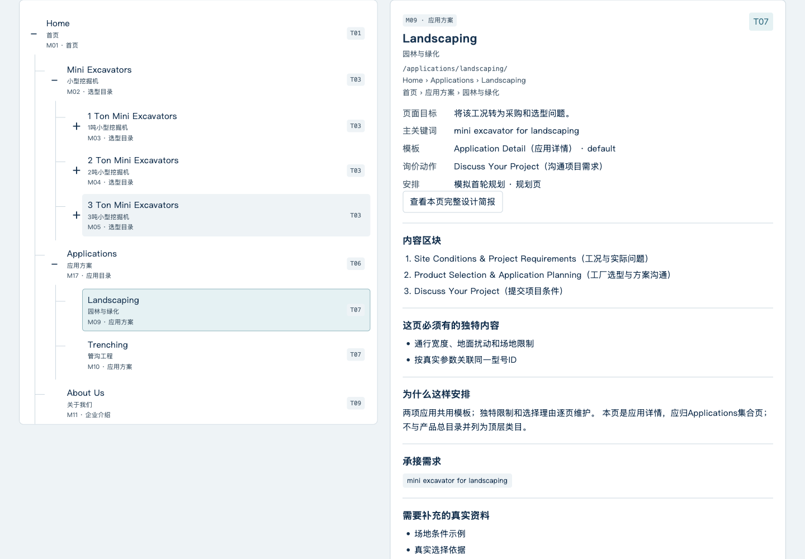

# B2B 网站架构规划 Skill

**把行业词库、竞争对手页面和企业资料，变成可以交给设计师或 AI 的网站规划。**

适合准备建设或改版英文外贸 B2B 网站的工厂、外贸企业和服务团队。当前版本：**0.4.1**。

它帮助你确定：网站建哪些页面、产品类目怎么分、应用方案怎么归类、类目页放哪些筛选器、产品详情需要填写哪些参数，以及哪些页面可以共用模板。

## 怎样安装到 Codex

把下面这段话复制给 Codex：

```text
请使用 $skill-installer 安装这个 Skill：
https://github.com/jackzhang1314/b2b-seo-site-architecture/tree/v0.4.1/skills/b2b-seo-site-architecture

请检查安装是否成功，并告诉我怎样调用。
这一步先完成安装，不开始网站规划或建站。
```

安装完成后，下一轮对话即可使用 `$b2b-seo-site-architecture`。如果当前界面还没显示，可以新建一个会话。安装同名旧版时，先让 Codex 核对版本、备份已有副本，再更新。

这是一份独立 Skill，所需脚本和 HTML 模板都已包含，**不用先安装整套 SEO Skill 或 WordPress Builder**。

使用环境需要：

- 能读取本地文件、使用 Skill 的 Codex。
- Python 3.11 或更新版本；脚本只用 Python 标准库。
- 进行竞品实访时，需要当前环境中可用、已授权的浏览器控制能力。缺少时可继续整理资料和做暂定方案，实访部分会明确标为未完成。

Skill 不包含 Ahrefs、Semrush 账号或付费数据。你已有的工具导出文件可以直接提供。

## 我需要提供什么

| 资料 | 可以直接提供的内容 |
| --- | --- |
| 企业与产品资料 | 实际产品、型号/材料、制造或供货范围、目标国家、英文站语言、图片与已有证书资料 |
| 行业关键词 | 产品种子拓词表、已有行业词库；原始 Excel 或 CSV 即可 |
| 竞争对手名单 | 域名或网址；已有筛选理由和指标可以一起附上 |
| 竞品排名与页面数据 | 关键词、排名位置、对应 URL；有搜索量、逐词流量或 Top Pages 页面流量，也一起提供 |
| 现有网站（改版时） | 网站地址、已有页面及可得的表现数据 |

**不用自己清洗表格、统一列名或制作 JSON。** 资料不齐也可以开始，Codex 会先读取已有资料，再告诉你当前最需要补哪一项。收到几万词时，会先用脚本处理全量数据。

## 安装后，怎样开始

把资料放进当前项目或作为附件提供，再复制：

```text
使用 $b2b-seo-site-architecture。

我提供企业与产品资料、行业词库、竞品名单，以及竞品排名关键词和对应 URL 表。
我们做英文外贸 B2B 网站。

请先用脚本统计词频、词组、产品属性和竞品页面承接的需求，再结合语义分析与浏览器实访，规划网站架构。

所有页面、类目、导航、模块标题和产品属性以英文为主，附中文翻译帮助我理解。
请明确应用方案集合页与二级详情的归属，规划产品类目筛选器和产品详情关键字段。

请交付简洁 HTML、研究报告、页面与模板清单、完整设计简报和资料缺口。
博客文章单独列计划，不把每篇文章塞进核心架构图。
先完成规划，暂不制作或发布网站。
```

只做一条产品线、排除博客或已有部分研究时，直接补充说明即可，不必重跑全部流程。

## 最后会拿到什么

| 成果 | 用来做什么 |
| --- | --- |
| `index.html` | 查看英文优先、中英对照的架构图、页面、导航、模板和产品属性 |
| `research-report.md` | 回查竞品核心页拆解、研究范围、采用理由和未完成项 |
| `pages.csv`、`navigation.csv`、`templates.csv` | 交给设计与建站团队，明确页面归属和模板复用 |
| `product-attributes.csv` | 明确属性的定义/单位、类目筛选用途、详情字段和缺值处理 |
| `design-briefs.md` | 每个核心页和模板代表页的完整设计要求，也可在 HTML 中直接复制给 AI |
| `content-plan.csv` | 单独管理博客选题、关键词、提纲和优先级 |
| 完整分析文件 | 保留词频、关键词去向、排名 URL、原始来源和覆盖统计；词库分析附 XLSX 阅读版 |
| `competitor-url-summary.csv`、`page-traffic-observations.csv` | 分开查看逐词流量和整页流量，保留只有整页流量的 URL；附 XLSX 阅读版 |
| `analysis-index.md`、`analysis/` | 从最终交付直接打开本轮完整分析，不用另找工作目录 |

网站页面需要的字段会写清类型、单位/格式、必填与否、资料来源和缺失时怎样处理。这里交付的是规划和设计依据，后续页面实现与网站发布另行开展。

Codex会在生成最终成果时自动附带选定的本轮分析。接收时保留整个成果目录或ZIP，HTML旁边的表格和分析文件也属于交付内容。模拟数据从导入到输出都标为`simulation`，不会为了运行改成真实资料。

首次使用的结构示例与报错说明见[可运行的最小示例](skills/b2b-seo-site-architecture/references/minimal-example.md)。它帮助Codex理解字段，你不需要手写JSON。

## 英文页面怎样配中文说明

实际英文网站采用英文名称；中文用于你审阅规划。示例：

```text
Home（首页）
├─ Mini Excavators（小型挖掘机）
│  ├─ 1 Ton Mini Excavators（1吨级小型挖掘机）
│  ├─ 2 Ton Mini Excavators（2吨级小型挖掘机）
│  └─ 3 Ton Mini Excavators（3吨级小型挖掘机）
└─ Applications（应用方案）
   ├─ Landscaping（园林与绿化）
   └─ Trenching（管沟工程）
```

Applications 是有内容的集合页，Landscaping 和 Trenching 是其下的应用详情。它们与产品分类承担不同任务。

下面是**合成挖掘机示例**的查看效果，不是真实客户或真实竞品结论：



## 几万关键词怎样分析

1. **脚本整理全量数据。** 去重、保留来源、统计单词与连续词组，区分词频、搜索量和估算流量。
2. **从线索下钻。** 例如发现 `ton`，再查 `1 ton / 2 ton / 3 ton` 及原词，提出类目、筛选和产品属性候选。
3. **结合页面和语义判断。** 看竞品同一 URL 承接哪些词，再按产品、采购任务和约束判断是否适合同页；商业页与博客页都纳入参考。
4. **结合真实业务落到架构。** 决定独立页、章节、筛选、详情参数或暂缓；未审阅和资料缺失继续明确标注。

比如 Weight Class（吨位等级）可以帮助分类；Operating Weight（工作重量）需要实际型号数值及单位。Overall Width（整机宽度）可以是详情参数，也可能用于筛选；数据不全时先保留填写要求，不虚构筛选范围。

HTML显示可读摘要并标明覆盖数量，全量文件仍保留。工具原生主题、脚本统计与模型判断分别记录。方法参考：[Ahrefs Terms / Parent Topic](https://ahrefs.com/academy/how-to-use-ahrefs/keywords-explorer/matching-terms)、[Semrush 分组与子组](https://www.semrush.com/kb/617-keyword-magic-tool-manual)。

## 当前验证范围

0.4.1 通过 104 项相关检查（架构/属性/证据/交付 80 项，内置词库工具 24 项），以及 Python 类型、代码和Skill结构检查。HTML检查覆盖1440桌面与390手机模拟下的11个视图、流量表搜索和设计任务复制。

原始挖掘机MOCK重跑保留41条词源、25词、16条排名和3条整页流量；最终交付含15组完整URL，包含没有逐词明细的页面。逐词与整页流量不相加，空值与真实0分开。该次脚本重跑沿用已有语义与页面判断。

另一次独立前向测试在计划生成阶段只使用冻结Skill与原始资料，重新做语义判断和公开网站研究，首次生成校验通过：15核心页、3个条件性文章选题、12类模板，最终自动附带6类分析运行的42个文件。研究覆盖三站19个真实URL，其中18个最新记录完整、1个部分；另列17个模拟URL，`research_complete`仍为false。没有修改Skill脚本来完成流程；测试者的辅助拆表代码曾修正一次CSV编码处理。方案生成后的报告收尾阶段读取了维护记录，因此最后的报告自查不称为完全盲态。此轮为同机隔离测试，不是新机器验收，也不代表真实SEO效果。

历史0.4.0合成规模验证处理了 **5 万个不同关键词、16 万行词源记录、10 万条排名关系、400 条页面流量记录**，本次0.4.1未重新执行该规模。它验证所测版本的数据处理能力；没有把分批结果当作已完成的语义分析，也不代表真实竞品研究或 SEO 效果。

版本与文件摘要见 [RELEASE.json](RELEASE.json)，变化见 [CHANGELOG](CHANGELOG.md)。维护者的发布范围和更新规则见 [发布说明](docs/PUBLISHING.md)。

旧版[v0.4.0](https://github.com/jackzhang1314/b2b-seo-site-architecture/releases/tag/v0.4.0)及其安装包继续保留；0.4.1沿用0.4.0计划结构。
